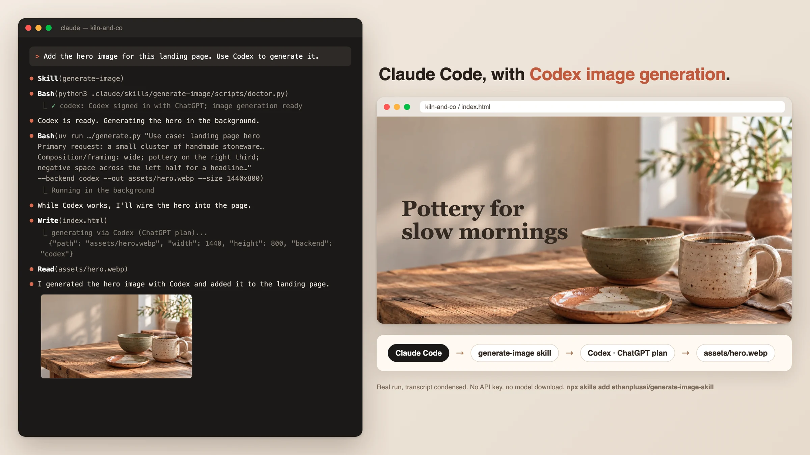
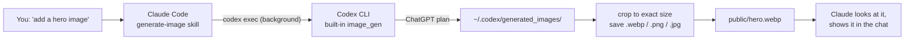

<p align="center">
  
</p>

<h1 align="center">generate-image-skill</h1>

<p align="center">
  <strong>Give Claude Code image generation using the ChatGPT plan you already pay for.</strong><br>
  Claude hands the job to Codex, Codex's built-in image tool makes it, and the finished image lands in your project and in the chat.<br>
  No API key. No model download. Falls back to free, offline FLUX on Apple Silicon.
</p>

<p align="center">
  <a href="https://www.skills.sh/ethanplusai/generate-image-skill"></a>
  <a href="https://github.com/ethanplusai/generate-image-skill/actions/workflows/ci.yml"></a>
  <a href="LICENSE"></a>
  
</p>

<p align="center">
  <a href="#install">Install</a> ·
  <a href="#how-it-works">How it works</a> ·
  <a href="#examples">Examples</a> ·
  <a href="#cli-reference">CLI</a> ·
  <a href="#setup--troubleshooting">Troubleshooting</a>
</p>

---

<p align="center">
  
  <br><sub>A real Claude Code run (transcript condensed). Asked for a hero image, Claude runs the skill, Codex makes the image on a ChatGPT plan, and Claude wires it into the page.</sub>
</p>

## Why

Codex can generate images; Claude Code can't. If you use Claude to build and
pay for ChatGPT, that's an image model you're already paying for that Claude
can't reach. This skill closes the gap. Claude now ships real hero images,
backgrounds, product shots and illustrations instead of gray boxes and
`placeholder.com` URLs, and it shows you each one before it goes in the page.

## Install

```bash
npx skills add ethanplusai/generate-image-skill
```

That installs the `generate-image` skill for Claude Code, Codex, Cursor, and
[other agents](https://www.skills.sh). Then make sure Codex is signed in with
ChatGPT:

```bash
npm install -g @openai/codex   # skip if you already have it
codex login                    # choose "Sign in with ChatGPT"
```

You'll also need [`uv`](https://docs.astral.sh/uv/) (`brew install uv`).
Then just ask: *"add a hero image to this page"*. Claude runs a setup check
the first time and walks you through anything that's missing.

<details>
<summary><b>Manual install</b></summary>

```bash
git clone https://github.com/ethanplusai/generate-image-skill
cp -R generate-image-skill/skills/generate-image ~/.claude/skills/   # Claude Code, all projects
# or: .claude/skills/ inside one project, or your agent's skills folder
```

</details>

## How it works



1. Claude plans the asset (prompt, exact pixel size, file path) and runs the
   skill's CLI as a background task.
2. The CLI runs `codex exec` headless: read-only, in a temp folder, without
   your MCP servers. It tells Codex to call its built-in image tool once.
3. It collects the finished file from Codex's output folder, cover-crops it
   to the exact size the layout needs, and saves it in your project.
4. Claude views the image, regenerates if it's off, wires it into the page,
   and shows it to you inline (in the Claude desktop app) or as a link.

No Codex? `--backend auto` falls back to **FLUX.1-schnell running locally on
Apple Silicon**: free, offline, Apache-2.0. Or bring an OpenAI, Gemini, or
Replicate API key.

## Examples

Same prompts through both backends. Nothing edited, and no cherry-picking
across dozens of tries.

<table>
  <tr>
    <th></th>
    <th>Codex (ChatGPT plan)</th>
    <th>Local FLUX.1-schnell (free, offline)</th>
  </tr>
  <tr>
    <td><b>Hero photo</b><br><sub><i>"warm natural-light photograph of a sunlit pottery studio, shelves of handmade ceramic bowls, soft morning atmosphere"</i></sub></td>
    <td></td>
    <td></td>
  </tr>
  <tr>
    <td><b>Product / og:image</b><br><sub><i>"bold minimal composition of a single terracotta ceramic bowl on a warm cream background"</i></sub></td>
    <td></td>
    <td></td>
  </tr>
  <tr>
    <td><b>Spot illustration</b><br><sub><i>"flat minimalist illustration of a paper airplane looping upward, two-tone terracotta and cream"</i></sub></td>
    <td></td>
    <td></td>
  </tr>
  <tr>
    <td><b>Background texture</b><br><sub><i>"abstract macro close-up of handmade paper texture, warm ivory tones, low contrast"</i></sub></td>
    <td></td>
    <td></td>
  </tr>
</table>

<sub>Full prompts: [`assets/showcase/codex/manifest.json`](assets/showcase/codex/manifest.json) and [`assets/showcase/manifest.json`](assets/showcase/manifest.json). Codex ~30–60 s per image; FLUX ~40 s on an M4 Pro.</sub>

## What you get

- **Images on your ChatGPT plan.** Codex's image model, with no API key and no per-image bill.
- **Exact sizes.** `--size 1440x800` gives you exactly 1440×800, cover-cropped from the closest shape the model supports.
- **Transparent cut-outs:** `--transparent` (Codex).
- **Edits and restyles:** `--ref photo.jpg "keep everything, change the sky to sunset"` (Codex).
- **Batches.** Plan a whole page's assets in one JSON file. Codex runs three at a time.
- **Consistent art direction.** One `imagegen.toml` styles every image in a project.
- **Shown in the chat.** The skill tells Claude to view every image and show it to you, not bury a file path in tool output.
- **Free offline fallback.** FLUX.1-schnell on Apple Silicon, with its ML stack installed only if you use it.

## Backends

| `--backend` | Model | Cost | Needs |
|---|---|---|---|
| `auto` (default) | `codex` if signed in with ChatGPT, else `local` | | |
| `codex` | Codex's built-in `image_gen` (OpenAI GPT Image) | your ChatGPT plan | Codex CLI + `codex login` |
| `local` | FLUX.1-schnell 4-bit via [mflux](https://github.com/filipstrand/mflux) | free, offline | Apple Silicon, ~7 GB one-time download |
| `openai` | `gpt-image-2` | per image | API key |
| `gemini` | `gemini-2.5-flash-image` | per image | API key |
| `replicate` | hosted flux-schnell | per image | API key |

API keys are stored in the macOS Keychain by you, at a hidden prompt. The agent
never sees them; see [Hosted API keys](#hosted-api-keys).

## CLI reference

Agents call this for you, but it works standalone too. Paths are relative to
the installed skill folder (for example `~/.claude/skills/generate-image`).

```bash
uv run scripts/generate.py "PROMPT" --out public/hero.webp --size 1440x800
uv run scripts/generate.py --batch assets.json
```

| Flag | Meaning |
|---|---|
| `--out PATH` | Output file; format from the extension: `.webp` (best for web), `.png`, `.jpg` |
| `--size WxH` | Exact output pixels, e.g. `1440x800` |
| `--backend NAME` | `auto` (default), `codex`, `local`, `openai`, `gemini`, `replicate` |
| `--transparent` | Transparent background (`codex`; `.png`/`.webp`) |
| `--ref IMAGE` | Reference or edit-source image, repeatable (`codex`) |
| `--count N` | N candidates: `hero-1.webp`, `hero-2.webp`, … |
| `--batch FILE` | JSON array of `{prompt, out, size, seed?, count?}` |
| `--json` | One JSON line per saved image (absolute path, size, seed, backend) |
| `--seed N` | Reproducible output on `local`/`replicate` (Codex ignores seeds) |
| `--steps N`, `--model REPO` | Local FLUX tuning |
| `--no-style` | Ignore the project's `imagegen.toml` |
| `--open` | Open results in Preview |
| `--dry-run` | Show the plan without generating |

### Consistent art direction

Drop an `imagegen.toml` at your project root and every image inherits the same look:

```toml
[style]
prefix = "warm editorial photography"
suffix = "muted earthy palette, soft natural light, film grain"
```

Start from [`imagegen.example.toml`](skills/generate-image/imagegen.example.toml).

## Setup & troubleshooting

Run the doctor. It's pure standard library, so it works on a stock Mac before
anything else is installed:

```text
$ python3 ~/.claude/skills/generate-image/scripts/doctor.py
generate-image-skill — environment check

  ✓ codex: Codex signed in with ChatGPT; image generation ready
  ✓ platform: Apple Silicon Mac
  ✓ uv: uv (/opt/homebrew/bin/uv)
  ✓ disk: 181 GB free disk
  ✓ memory: 48 GB RAM
  ! model: local model not downloaded (not needed while Codex is ready)
  ✓ default backend: codex (your ChatGPT plan)

Ready to generate. The ! notes above are advisory, not blockers.
```

| Symptom | Fix |
|---|---|
| `Codex exited with an error … codex login` | Sign-in expired or not ChatGPT: run `codex login`. |
| `Codex finished but produced no image` | Plan image quota used up, or the feature is off: `codex features enable image_generation`. |
| `uv: command not found` | `brew install uv` (or `curl -LsSf https://astral.sh/uv/install.sh \| sh`). |
| `the local backend requires an Apple Silicon Mac` | Use Codex or a hosted key on other machines. |
| First local run "hangs" | It's downloading the ~7 GB FLUX model, one time only. Give it 10 minutes. |

## Hosted API keys

Only needed for `openai`, `gemini`, or `replicate`. Store a key once; it's
typed at a hidden prompt and kept in the macOS Keychain, never in a prompt,
transcript, or shell history:

```bash
uv run scripts/generate.py --set-key openai      # or gemini, replicate
uv run scripts/generate.py --list-keys
uv run scripts/generate.py --delete-key openai
```

Adding a provider takes one class and one entry in `HOSTED_BACKENDS` in
[`backends.py`](skills/generate-image/scripts/backends.py). PRs welcome.

## Is the local backend really free?

Yes. FLUX.1-schnell is [Apache 2.0](https://huggingface.co/black-forest-labs/FLUX.1-schnell),
so commercial use of the model **and its output** is fine. The only costs are
~7 GB of disk and ~40 s of your Mac's GPU per image. (FLUX.1-dev looks slightly
nicer but is non-commercial, which is why this uses schnell.) To reclaim the
disk: `rm -rf ~/.cache/huggingface/hub/models--dhairyashil--FLUX.1-schnell-mflux-4bit`.

## Repo layout

```
skills/generate-image/   ← the skill (all that `npx skills add` installs)
  SKILL.md               agent instructions
  scripts/               CLI, backends, doctor (uv-run, deps inline)
  reference/             prompt recipes per asset type
tests/                   pytest suite, no model or network needed
assets/                  README images
```

## Roadmap

- Transparent output and reference images for the local backend
- CUDA / Linux local backend
- Warm daemon mode for local FLUX (skip the ~20 s model load)

Issues and PRs welcome. See [CHANGELOG.md](CHANGELOG.md) for what's new.

## License

Code: [MIT](LICENSE). FLUX.1-schnell weights: Apache 2.0. Images from the
`codex`, `openai`, and `gemini` backends follow OpenAI's and Google's terms.
